  

# ⚡ Awesome Automated Accessibility Testing (A11Y) 🌐

> 🔍 A comprehensive, curated directory of **automated digital accessibility (a11y) testing engines, open-source frameworks, developer CLI tools, and enterprise SaaS compliance platforms**. Ensure continuous adherence to **WCAG 2.1/2.2, Section 508, EN 301 549, and the Americans with Disabilities Act (ADA)**.

---

## 📑 Table of Contents
- [✨ Key Highlights & SEO Keywords](#-key-highlights--seo-keywords)
- [📈 Sector Overview & Market Dynamics](#-sector-overview--market-dynamics)
- [🏢 SaaS Accessibility Platforms & Solutions](#-saas-accessibility-platforms--solutions)
- [💻 Open-Source Frameworks & Developer Testing Tools](#-open-source-frameworks--developer-testing-tools)
- [📊 Star History](#-star-history)
- [💖 Support & Contributing](#-support--contributing)
- [📄 License](#-license)

---

## ✨ Key Highlights & SEO Keywords
* **Core Compliance Standards:** WCAG 2.0, WCAG 2.1, WCAG 2.2 (Level A, AA, AAA), Section 508, European Accessibility Act (EAA), EN 301 549, ADA Title II/III.
* **Testing Dimensions:** Headless browser automation, Continuous Integration / Continuous Deployment (CI/CD) pipelines, AST linters, synthetic monitoring, screen reader simulation, and accessibility tree inspection.
* **DevOps Integrations:** GitHub Actions, GitLab CI, Playwright, Cypress, Puppeteer, Selenium, Jest, Storybook, and Vitest.

---

## 📈 Sector Overview & Market Dynamics

The digital accessibility software and automated testing sector is valued at approximately **$850 million to $930 million**, with the broader accessibility testing, continuous monitoring, and remediation services ecosystem exceeding **$3.8 billion** and projected to surge past **$10 billion** at a 7%–12% CAGR. Driven by strict enforcement of the **European Accessibility Act (EAA)**, DOJ **ADA Title II rules**, and SEC/ESG inclusion mandates, accessibility testing has transformed from an ad-hoc audit practice into an essential shift-left CI/CD automated requirement.

The sector is **moderately fragmented**. Rather than a winner-take-all monopoly, the market is balanced across specialized pure-play digital governance vendors (like Deque and Level Access), end-to-end cloud browser execution grids (such as BrowserStack), front-end remediation overlays, and ubiquitous open-source engines embedded into developer toolchains worldwide.

---

## 🏢 SaaS Accessibility Platforms & Solutions

Below is the verified breakdown of leading SaaS digital accessibility and automated compliance platforms, categorized with specific starting-tier pricing, exact free tier / trial limits, and verified company scale (valuation / revenue), **sorted descending by company size**:

| 🏷️ Platform | 🧩 Category | 💼 Company Size (Valuation / Revenue) | 💵 Pricing (Starting Tier) | 🎁 Free Tier / Trial Limits |
|---|---|---|---|---|
| **[BrowserStack Accessibility Testing](https://www.browserstack.com/)** | ☁️ Cloud Browser Testing & Scanner | **$4B valuation** (~$230M ARR) | Starting at **$89/domain/month** (or bundled with Test Companion / Automate tiers from $29/mo) | **Free Trial:** 30 minutes Live manual testing, 100 minutes automated test runs; Percy visual testing includes 5,000 free screenshots/month |
| **[Siteimprove](https://www.siteimprove.com/)** | 🏛️ Enterprise Digital Governance & QA | **$911M valuation** (acquired) / ~$100M ARR | Benchmark starting tier **~$15,000/year** (custom quote based on page count & modules) | **No full platform trial / permanent free tier.** Standalone browser extension & single-page audit tool limited strictly to 1 URL per manual scan |
| **[Evinced](https://www.evinced.com/)** | 🤖 Enterprise CI/CD & Mobile A11Y | **$220M valuation** ($112M raised) / ~$34M ARR | Starting tier estimated at **$500–$2,000/month** (billed annually via custom enterprise quote) | **14-day Free Trial:** Site Scanner trial capped at 50,000 total URLs crawled/scanned and max 1,500 pages per scan (no credit card required) |
| **[Level Access](https://www.levelaccess.com/)** | 🛡️ Enterprise Compliance Platform | **>$100M ARR** (PE-backed by KKR & JMI) | Mid-market benchmark starting at **$75,000/year** (enterprise quote based on portfolio scope) | **No open free tier / free trial.** Access is demo-only; requires an enterprise contract |
| **[Deque Systems (axe DevTools)](https://www.deque.com/axe/devtools/)** | ⚙️ Developer Tooling & Scanning Platform | **~$40M–$100M revenue** (Privately held) | Pro browser extension starting at **$60/user/month** (or ~$45–$50/mo billed annually); Enterprise Monitor quote-based | **Free Forever Tier:** axe DevTools browser extension covers core automated checks (~57% of WCAG issues) on single pages. **14-day Free Trial** for Pro (unlocks Intelligent Guided Testing, no credit card required) |
| **[UserWay](https://userway.org/)** *(acquired by Level Access)* | 🧩 Accessibility Widget & Automation | **$98.7M acquisition valuation** (~$15M–$20M ARR) | Starting at **$490/year** (for sites up to 100K monthly page views) | **Free Forever Tier:** Basic client-side widget UI (contrast/text adjustments only; no automated AI fixes or legal compliance). **Free trial** available for Pro monitoring (capped at 50 pages) |
| **[accessiBe](https://accessibe.com/)** | 🪄 AI Accessibility Widget & Scanning | **~$51M ARR** ($58M funding raised) | Starting at **$490/year** (Standard plan for sites under 1,000 pages) | **7-day Free Trial:** Full feature access for 1 domain (no credit card required). Includes free spot-check tool (accessScan) for single-page audit |
| **[Silktide](https://silktide.com/)** | 🌐 Automated Web Governance & Scanning | **~$2.5M–$3M ARR** (Bootstrapped / Private) | Starting at **£5,000/year** (~$6,500/yr for up to 1,000 pages via UK G-Cloud rate card) | **No platform free trial.** Free standalone browser extension covers single-page manual WCAG checks; free homepage scan tool limited strictly to 1 homepage URL |
| **[Pope Tech](https://pope.tech/)** | 🎯 Automated Scanning (WAVE Engine) | **~$800K–$1M ARR** (Bootstrapped / Private) | Team tier starting at **$25/month** (or Business Plus at $225/mo, Professional at $400/mo) | **Free Forever Tier:** Up to 25 pages/month for 1 website, 1 group, and 2 users with unlimited rescanning |
| **[Tenon.io](https://tenon.io/)** *(acquired by Level Access)* | 🔌 API-first Accessibility Testing | **<$1M revenue** (acquired historical) | Starting at **$90/month** (priced on API scan request volumes) | **30-day Free Trial:** Includes limited initial API call credits for evaluation; historical single-page test console |

---

## 💻 Open-Source Frameworks & Developer Testing Tools

The following table lists top open-source accessibility engines, AST linters, testing harnesses, and CI/CD CLI tools, **sorted descending by GitHub star count**. Each repository name links to the project and is accompanied by a social star count badge directly linked to that repo's stargazers page:

| 📦 Open-Source Repository | 🌟 Stars Badge | 🛠️ Ecosystem / Scope | 📖 Description & Capabilities |
|---|---|---|---|
| **[GoogleChrome / lighthouse](https://github.com/GoogleChrome/lighthouse)** |  | Chrome / Node.js / CLI | Automated auditing tool for web performance, SEO, progressive web apps, and automated WCAG accessibility verification. |
| **[dequelabs / axe-core](https://github.com/dequelabs/axe-core)** |  | JavaScript / Zero-Dependency | The defacto open-source accessibility rules engine; powers Chrome DevTools, Lighthouse, and major end-to-end test runners. |
| **[pa11y / pa11y](https://github.com/pa11y/pa11y)** |  | Node.js / CLI / CI | Automated accessibility testing runner via headless Chromium; supports customized standards, reporters, and configuration profiles. |
| **[jsx-eslint / eslint-plugin-jsx-a11y](https://github.com/jsx-eslint/eslint-plugin-jsx-a11y)** |  | ESLint / React / JSX | Static AST linting rules for immediate accessibility validation on JSX elements inside front-end developer IDEs. |
| **[squizlabs / HTML_CodeSniffer](https://github.com/squizlabs/HTML_CodeSniffer)** |  | Client-side JS / Bookmarklet | Client-side script that evaluates HTML source code against WCAG 2.1 and Section 508 standards; core driver in Pa11y. |
| **[nickcolley / jest-axe](https://github.com/nickcolley/jest-axe)** |  | Jest / Vitest / Unit Tests | Custom Jest and Vitest matchers for `axe-core` to assert accessibility expectations on rendered React, Vue, and HTML elements. |
| **[microsoft / accessibility-insights-web](https://github.com/microsoft/accessibility-insights-web)** |  | Chrome & Edge Extension | Microsoft's open-source suite helping developers diagnose and resolve WCAG 2.1 AA compliance barriers via FastPass and guided assessments. |
| **[IBMa / equal-access](https://github.com/IBMa/equal-access)** |  | IBM / Node / Karma / Cypress | IBM Equal Access accessibility checker and automated test engine across browser extensions, CLI tools, and Karma plugins. |
| **[component-driven / cypress-axe](https://github.com/component-driven/cypress-axe)** |  | Cypress E2E | Inject and execute `axe-core` assertions seamlessly across Cypress UI end-to-end and component tests. |
| **[AccessLint / screenreaders](https://github.com/AccessLint/screenreaders)** |  | Node.js / VoiceOver | Programmatic JavaScript driver for VoiceOver on macOS, enabling automated screen-reader interaction verification. |
| **[Siteimprove / alfa](https://github.com/Siteimprove/alfa)** |  | TypeScript / W3C ACT-Rules | Open-source accessibility engine by Siteimprove strictly implementing W3C ACT (Accessibility Conformance Testing) rules. |
| **[AccessLint / accesslint](https://github.com/AccessLint/accesslint)** |  | GitHub App / CI | Continuous accessibility linting on pull requests that spots code accessibility issues before merging into production. |

---

## 📊 Star History

---

## 💖 Support & Contributing

Thank you for visiting and supporting the **Awesome Automated Accessibility Testing** project! 🙌

Digital accessibility makes the web equitable for everyone. If you found this directory valuable, here is how you can help support our work:
* ⭐ **Star this repository** to help other developers discover automated a11y testing tools.
* 🍴 **Fork and contribute** by submitting a pull request with new tools, frameworks, and updated benchmark data.
* 📢 **Share** this repository on social media, developer channels, Discord, and tech blogs.
* ☕ **Buy me a coffee / Sponsor:** If this repository helped you in your workflow or organization, please consider supporting ongoing maintenance on the [GitHub Sponsors Dashboard](https://github.com/sponsors/ishandutta2007).

---

## 📄 License

This curated list is open-source and released under the [MIT License](LICENSE).
